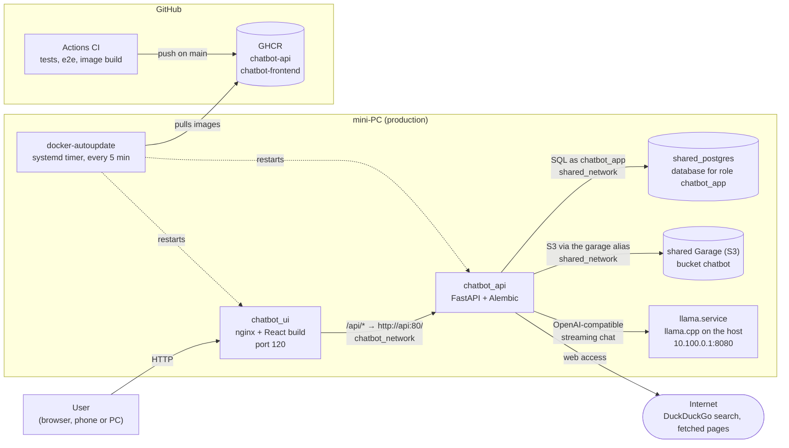
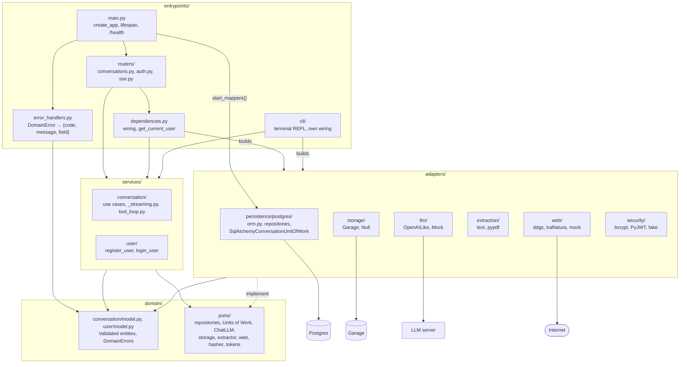

# Architecture

Chatbot is a persistent multi-conversation chat over a local LLM (any
OpenAI-compatible server; in production llama.cpp on the mini-PC). Each user has
their own conversations, can attach files, and can let the model search the web. It
has a web UI and a terminal CLI that share the same use cases. The backend is
ports-and-adapters (hexagonal), rich form (BLUEPRINT §3b); the frontend is React with
TanStack Query.

## Containers



In production (`deployment/docker-compose.yml`) the API connects to the fleet's
`shared_postgres` as its own least-privilege role `chatbot_app` and runs
`alembic upgrade head` at every start (`backend/entrypoint.sh`). Attachments go to
the shared Garage, reached through the `garage` alias (`http://garage:3900`), never
`shared_garage`: botocore rejects a hostname with an underscore. The `chatbot` bucket
must be in Infrastructure's `GARAGE_BUCKETS` before the first deploy. The LLM is the
host's `llama.service`, reached on the `shared_network` gateway, shared with the
other apps. A push to `main` builds new images; `docker-autoupdate` pulls them within
about five minutes.
The Deployer app (or `deployment/deploy.sh`) copies the compose file and
`.env.example` to the mini-PC, and `chatbot-stack.service` starts the stack at boot.

Locally (`docker compose --profile app`, and the `chatbot_e2e` project for e2e) the
same `frontend` → `api` pair uses its own throwaway `db` and `garage` containers.
With `LLM_BASE_URL` empty the API uses the mock LLM, and with
`WEB_TOOLS_ENABLED=false` the mock web tools; e2e sets both. The CLI (`make cli`)
talks to the database and the LLM in-process, without the API.

## Backend layers

```text
entrypoints/   ── FastAPI routers, SSE framing, schemas, wiring, settings, the CLI
services/      ── one use case per module, over a Unit of Work and ports
adapters/      ── persistence, LLM, storage, extraction, web, security
domain/        ── Validated entities, DomainError family, ports (pure)
```

The package is `backend/src/chatbot/` (src-layout). Outer layers import inner ones,
never the reverse ([ADR-001](adr/001-ports-and-adapters.md)).



Inside the backend, solid arrows point the way imports go and dotted ones go from the
adapters to the ports they implement; arrows leaving the backend are network calls.
Services see only the ports; `dependencies.py` and the CLI's
`cli/dependencies.py` pick the adapters.

- **`domain/`** — two packages, `conversation/` and `user/`, each with a `model.py`
  and a `ports/` folder. Entities are dataclasses mixing in `Validated`
  (`domain/validated.py`): every field is checked on creation and on assignment
  (`Role`, `Temperature` 0–2, `MaxTokens` ≥ 1, `Language`, `Username` with a non-space
  character, `ToolEvent` / `ToolResult`). Expected failures are `DomainError`
  subclasses (`domain/errors.py`) with a stable `code`, defined next to their
  entities: `ConversationNotFound`, `MessageNotFound`, `AttachmentNotFound`,
  `NothingToRegenerate`, `AttachmentTooLarge`, `UsernameTaken`,
  `InvalidCredentials`, `InvalidToken` / `TokenExpired`, `UserNotFound`. The ports:
  `AbstractConversationRepository`, `AbstractConversationUnitOfWork`, `ChatLLM`,
  `AbstractAttachmentStorage`, `AbstractTextExtractor`, `WebSearch` / `PageFetcher`
  (`ports/web_tools.py`), `AbstractUserRepository`, `AbstractUserUnitOfWork`,
  `PasswordHasher` and `TokenService`.
- **`services/`** — one module per use case, each a class taking a Unit of Work
  factory and the ports it needs. `services/conversation/`: `create_conversation`,
  `list_conversations`, `get_conversation`, `update_conversation` (rename and
  settings in one partial update), `delete_conversation` (then a best-effort
  `delete_prefix` of the conversation's blobs), `upload_attachment`,
  `download_attachment`, and the three streaming ones `send_message`,
  `regenerate_message`, `edit_message`. Shared code: `_streaming.py` (the
  stream-then-persist tail, history building, config resolution), `tool_loop.py`
  (web access) and `language.py` (the reply-language directive).
  `services/user/`: `register_user`, `login_user`. Services raise only
  `DomainError`s and never import `bcrypt`, `jwt` or boto3.
- **`adapters/`**
  - `persistence/postgres/` — async SQLAlchemy (asyncpg). `orm.py` maps the domain
    classes onto the `users`, `conversations`, `messages` and `attachments` tables
    imperatively; `start_mappers()` runs once from FastAPI's `lifespan` and from the
    CLI's `build_context()`. Relationships are `lazy="raise"`, so every query says
    what it loads. `PostgresConversationRepository` and `PostgresUserRepository`
    load and save the entities; `SqlAlchemyConversationUnitOfWork` implements both
    UoW ports on one session. Deleting a user deletes their conversations; deleting
    a conversation deletes its messages and attachment rows.
  - `llm/` — `OpenAILikeLLMAdapter` streams `/v1/chat/completions`
    (`LLM_BASE_URL`, `LLM_API_KEY`, `LLM_MODEL`); `MockLLMAdapter` is used when
    `LLM_BASE_URL` is empty.
  - `storage/` — `GarageStorageAdapter` (boto3, every call in the anyio thread
    pool) and `NullAttachmentStorage`, an in-memory fallback when `GARAGE_ENDPOINT`
    is empty.
  - `extraction/` — `TextExtractionAdapter`: UTF-8 text, `pypdf` for PDFs, `None`
    for images; never raises, truncates to `ATTACHMENT_MAX_EXTRACTED_CHARS`.
  - `web/` — `DdgsWebSearch` (DuckDuckGo via `ddgs`) and `TrafilaturaPageFetcher`,
    whose SSRF guard rejects non-http(s) URLs and private, loopback or reserved
    hosts, on the first request and on every redirect hop. `mock.py`
    (`MockWebSearch`, `MockPageFetcher`) replaces both when
    `WEB_TOOLS_ENABLED=false`.
  - `security/` — `BcryptPasswordHasher`, `PyJwtTokenService` and
    `FakePasswordHasher` (tests only).
- **`entrypoints/`** — `routers/conversations.py` and `routers/auth.py` call a use
  case and never `try/except`; `routers/sse.py::sse_stream()` frames streams;
  `routers/limiter.py` is slowapi's limiter for `POST /auth/login`. `schemas.py`
  holds the Pydantic request and response models. `dependencies.py` wires adapters
  and use cases, and `get_current_user` turns the bearer token into a user id.
  `error_handlers.py` turns every error into `{code, message, field}` (slowapi's 429
  arrives as `http_429`). `settings.py::Settings` is the only reader of the
  environment, for the API and the CLI; `JWT_SECRET_KEY` and the database settings
  are required. `logging_setup.py` puts the request id on
  every line and in the `X-Request-ID` header. `main.py` follows D4: `create_app()`
  only builds the app, and `lifespan` checks settings, configures logging and maps
  the ORM, so importing the app needs no env vars (unit tests, `make types`).
  `GET /health` is unauthenticated, writes no access line and is not in the OpenAPI
  schema. There is no CORS: the browser reaches the API same-origin. `cli/` is a
  terminal REPL that wires the same use cases in-process, without HTTP. It has no
  login: it acts as the user named in `CHATBOT_CLI_USER` (or the only user), and
  replies in `CHATBOT_LANGUAGE`.

Canonical copies from `Apps/shared/` (checked by `make drift`): `domain/errors.py`,
`domain/validated.py`, `entrypoints/error_handlers.py`, `logging_setup.py`,
`settings_base.py`, and the three `adapters/security/` adapters.

## Model

- **`Conversation`** — `title` (set from the first user message, cut to 60
  characters), its `messages`, the owning `user_id`, and three nullable overrides:
  `temperature`, `max_tokens`, `system_prompt_override`. `None` means "use the server
  default", never `0` or an empty string. `PATCH /conversations/{id}` is one partial
  update for the title and these settings; an explicit `null` resets one.
- **`Message`** — `role` (`user` or `assistant`), `content`, and for assistant
  replies `thinking` (the model's reasoning) and `tool_events` (web-access activity).
  Both are stored and shown, but never sent back to the LLM as history.
  `attachments` are the files linked to a user message.
- **`Attachment`** — a file uploaded to a conversation and stored in Garage under
  `conversations/{cid}/{attachment_id}/{filename}`. It is pending (`message_id` is
  `None`) until the message that sends it links it. `extracted_text` is the text the
  model sees, lifted at upload; it is `None` for images. Downloads stream through the
  backend ([ADR-004](adr/004-attachments-in-garage.md)).
- **`User`** — `username`, `hashed_password`, and `language` (`en`, `it` or `de`) for
  the UI and the reply language. Registration is open; the first user to register
  adopts the conversations created before multiuser (`claim_orphans`). Login returns
  a JWT bearer token ([ADR-006](adr/006-multiuser-jwt-auth.md),
  [ADR-007](adr/007-multilanguage.md)).

Ownership is a predicate in the repository: `get`, `list` and `delete` take the
`user_id`, so another user's conversation is simply not found
(`ConversationNotFound` → 404). There is no separate authorization layer.

Generation parameters are not stored in the LLM adapter: each call gets a frozen
`ChatParams(temperature, max_tokens, enable_thinking)`.
`_streaming.py::resolve_chat_config` builds it from the conversation's overrides,
the server defaults and the turn's thinking toggle (`None` → server default), and
`language.py::apply_language` appends the user's reply-language instruction after
the system prompt (nothing for `en`). The adapter sends `temperature` and
`max_tokens` only when they are set.

## Streaming

`POST /conversations/{id}/messages`, `.../messages/regenerate` and
`.../messages/{message_id}/edit` stream the reply. The use cases are async
generators that yield plain event dicts, a union keyed by `type`
([ADR-003](adr/003-typed-sse-event-protocol.md)):

- `{"type":"token","content"}` and `{"type":"thinking","content"}`;
- `{"type":"tool_start","id","tool","query"|"url"}` and
  `{"type":"tool_end","id","tool","ok","summary","results"}` (web access);
- `{"type":"done","message_id"}` (`null` when nothing was generated);
- `{"type":"error","code","message"}`, where `code` is the domain error's code, as in
  HTTP error bodies (`_streaming.py::error_event`).

`routers/sse.py::sse_stream()` frames each event as `data: {json}\n\n`; the CLI
consumes the same dicts in-process (`cli/rendering.py::stream_events`). There is no
protocol version: frontend, CLI and backend ship together.

Each streaming use case uses two Units of Work. The first saves the user message (or,
for regenerate and edit, deletes the messages being replaced), links pending
attachments, builds the history and resolves the config, then commits, so the user
message is saved before the LLM answers. Then `_streaming.py::stream_and_persist`
streams the reply and, in its `finally`, saves what arrived in a second Unit of Work.
The use cases wrap it in `contextlib.aclosing`, so a reply cut short by the client
is saved too.

- **Stop** is a client-side abort: the frontend aborts the request, the generator is
  closed, the partial reply is saved, and the frontend refetches the conversation.
- **History** — `build_history` sends user turns with each attachment's text inlined
  as `[Attached file: {name}]` followed by the text; the stored message content stays
  as the user typed it.
- **Web access** (send only, when the turn asks for it): `tool_loop.py::run_tool_loop`
  replaces the plain stream. The model asks for `web_search` or `fetch_page` in a
  fenced `tool_call` block that `ToolCallScanner` picks out of the token stream;
  thinking is forced off for that turn
  ([ADR-005](adr/005-prompted-json-tool-protocol.md)).

## Frontend

React 19 + TypeScript + Vite + TanStack Query, in three layers; outer uses inner only:

```text
components/   ── render + UI state; show the error text from messageFor[lang]
hooks/        ── TanStack Query queries, mutations and the stream state machine
api/          ── generated schema.d.ts, the one openapi-fetch client, errors, session, SSE reader
```

- **`src/api/`** — `schema.d.ts` is generated from the backend's OpenAPI by
  `make types` (offline) and never edited. `client.ts` and `messages.ts` are canonical
  copies (`make drift`): `client.ts` is the one `openapi-fetch` client (base URL
  `/api`), and every failure becomes an `ApiError` with a stable `code`. `errors.ts`
  gives `messageFor[lang]`, the error-to-text function, with one `makeMessageFor` table per language. Unlike
  §4b's Italian-only text, Chatbot has EN, IT and DE (ADR-007): `en` and `de` override
  every common code, `it` adds only Chatbot's codes, and an unknown code gets the
  canonical Italian fallback. `session.ts` stores the token (`chatbot_token`), reads
  the `username` claim, and `makeAuthMiddleware` (registered in `main.tsx`) adds the
  bearer header; on a 401 or 403 it clears the token and reloads, but only if the
  request carried a token, so a wrong password reaches the login form.
  `stream.ts::readEvents` parses the SSE body into `StreamEvent`s: an `error` event
  throws an `ApiError` with its `code`, a connection broken mid-body becomes
  `network_error`, an abort is rethrown.
- **`src/hooks/`** — every hook gets its client from `useApi()`. This deviates from
  Famiglia, whose hooks import `api` directly: openapi-fetch captures `fetch` when a
  client is created, so tests could not swap it. The context's default is the
  app-wide `api`, so the app needs no provider; tests wrap in `ApiProvider`.
  `main.tsx` sets up `QueryClientProvider` (reads retry once, writes never).
  - `useConversations.ts` — the backend type aliases (`Conversation`, `Message`,
    `Attachment`, …; `tool_events` is cast to `ToolEvent[]` in `toConversation`),
    the keys `conversationsKey` / `conversationKey(id)`, `useConversationList`,
    `useConversation`, and the writes: create, rename, delete, `useUpdateSettings`,
    `useUploadAttachment` and `useDownloadAttachment` (a blob through the client,
    since a plain link can't carry the bearer header). Detail queries never refetch
    on their own (`staleTime: Infinity`, no refetch on focus): `useChatStream` writes
    optimistic messages into that cache entry, and a background refetch would wipe
    them mid-stream. Only opening a chat (`fetchQuery` with `staleTime: 0`) and the
    end of a stream refresh it.
  - `useActiveConversation.ts` — `activeId` (`null` is a draft), `threadKey`,
    `select`, `startNew`, `forget`, `ensureConversation` (see *Draft chat*).
  - `useChatStream.ts` — send, regenerate and edit, with client-side stop. It reads
    the stream with `readEvents`, keeps `streamingThinking` and
    `streamingToolEvents` for the bubble, and after every stream refetches the
    conversation and invalidates the list.
  - `useProfile.ts` (`GET /auth/me`), `useAuth.ts` (`useLogin`, `useRegister`,
    `isSignedIn`, `currentUsername`, `logout`, so `App` doesn't import
    `api/session`), `useMobileLayout.ts` (no server data).
- **`src/components/`** — never import `api` or call `fetch`, never read status codes
  or server text. `App` wires the state, with `TopBar`, `SidebarDrawer`
  (`ConversationList`), `Greeting`, `ErrorBanner`, `ConversationSettings` (the ⚙
  popover) and `LanguageSwitcher`; `AuthPage` is shown until there is a token.
  `ChatThread` → `MessageBubble` → `AttachmentChips`, `CodeBlock`, `ActionButton`,
  `ThinkingBlock`, `ToolActivity`. `MessageInput` → `PendingChips`,
  `ComposerToggles` (🌐 web access and 🧠 thinking, per message and remembered in
  `localStorage`; thinking through `utils/prefs.ts` so regenerate and edit read the
  same value; 🧠 is disabled while 🌐 is on).
- **`src/test/`** — `fakeServer.ts` is a hand-written `FakeServer` that answers
  JSON or SSE (complete, or waiting for the abort) and records requests;
  `render.tsx` has `renderApp(server)` and `providersFor(server)`. No `vi.mock`, no
  network.

## Draft chat

The app never creates a conversation up front. A draft is `activeId === null` in
`useActiveConversation`: no row, no messages, no request. The homepage, "+ New chat"
and deleting the open conversation all land on a draft. The composer is always
shown; a draft or an empty chat shows `Greeting` instead of `ChatThread`, and the ⚙
settings are hidden until the chat exists. `ensureConversation()` creates the row on
the first send or upload: it POSTs, seeds `conversationKey(id)` with the new, empty
conversation so the thread renders at once, and opens it if the user is still on the
draft. Callers use the id it returns, never state read back, and a `creatingRef`
promise makes concurrent calls (several files picked at once) share one create.
`useChatStream`'s send awaits it on a draft; regenerate and edit do nothing on one.

`MessageInput` is keyed by `threadKey`, which changes on select, new and delete but
not when a draft becomes a real chat, so staged text and attachments survive that
moment.

## Where errors show

Components keep the caught error and render the text `messageFor[lang]` gives for it, never
`err.message`, a status code or server text.

- **Banner** (`ErrorBanner`, `role="alert"`, × to dismiss, top of the chat area):
  opening a chat (the current one stays on screen), rename, delete, settings save,
  download, a failed create on the first send, and a list that never loaded. A failed
  refetch of a list already on screen stays silent. One error at a time: a newer one
  replaces it.
- **Under the thread** (`ChatThread`): a stream that failed, only in the chat it
  belongs to; the next stream clears it. Stop is not a failure: `useChatStream`
  checks its own `signal.aborted`, because `client.ts` turns an abort before the
  response into `network_error`.
- **By the input** (`MessageInput`): the last failed upload; a failed file is never
  staged.
- **Silent**: the profile load, the refresh after a stream, the language save.

## i18n

EN, IT and DE through a small homegrown layer, no library
([ADR-007](adr/007-multilanguage.md)). `src/i18n/strings.ts` is the typed catalog per
language (`{name}` interpolation, missing keys fall back to English) with the pure
`translate` / `interpolate`; `src/i18n/index.tsx` has `LanguageProvider` (wrapping
the app in `main.tsx`) and `useT()` / `useLanguage()`. The first language comes from
`localStorage` (`chatbot_lang`), then `navigator.language`, then `en`. After login,
`App` reads `useProfile()` and calls `syncLanguage` with the stored value (saved
locally, not sent back). `LanguageSwitcher` (in the top bar and on the auth page)
changes the UI, saves it locally and, when signed in, sends `PATCH /auth/me`. The
backend uses the same `users.language` for the reply-language instruction.

## Look and rendering

- **Theme** — a light "paper" palette as CSS custom properties in `index.css`
  (`--bg`, `--surface`, `--accent` terracotta, …); components use `var(--…)`, with
  `#fff` the only literal, for text on the accent. Fonts: Lora (serif, headings) and
  Inter (body) from Google Fonts in `index.html`, with Georgia and system-ui as the
  offline fallbacks.
- **Responsive** — components style with inline objects, but media queries can't be
  inline, so a few classes in `index.css` (`.app-shell`, `.top-bar`, `.composer`,
  `.chat-thread`, `.icon-btn`, `.bubble`) change at 640px (`MOBILE_BREAKPOINT`). The
  JS `mobile` flag from `useMobileLayout` is only for structure: the sidebar becomes
  a drawer and the username is hidden.
- **Messages** — `MessageBubble` renders assistant replies with `react-markdown`,
  `remark-gfm`, `remark-math` + `rehype-katex` and `rehype-highlight` (the highlight.js
  `github` theme, imported in `main.tsx`). Fenced code goes through `CodeBlock`
  (language label and a Copy button); assistant messages also have a Copy-message
  action. Copying uses `utils/clipboard.ts`, which falls back to
  `document.execCommand("copy")` because `navigator.clipboard` is missing over plain
  HTTP on the LAN. Before the first token the bubble shows pulsing dots, then a
  blinking caret. `ThinkingBlock` shows the reasoning above the answer: open while it
  streams, collapsed once the answer starts and on reload. `ToolActivity` shows the
  web-access chips, live or from `message.tool_events`.
- **nginx** — `frontend/nginx.conf` serves the build and proxies `/api/` to
  `http://api:80/` with `proxy_buffering off` for SSE.
